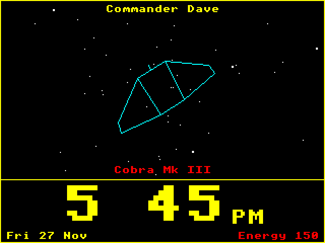
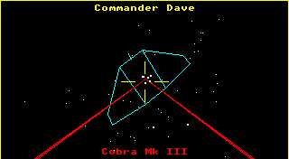
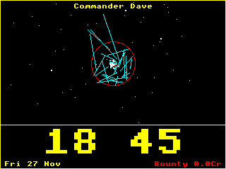
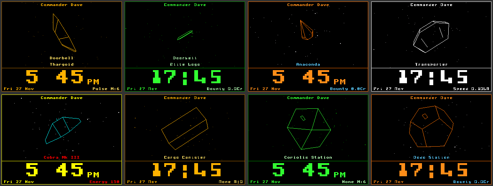

# CYD-Elite

Elite ships tumbling through space, with a clock, on a ~$15 ESP32-2432S028 "Cheap Yellow Display".
It runs ESPHome, so Home Assistant finds it automatically and every setting (including your
**Commander name**) is an entity you can change from HA.



## Features

- **32 ships and objects** from 6502 Second Processor Elite, taken from the original blueprints
  (vertices, edges and face normals) via Mark Moxon's [bbcelite.com](https://elite.bbcelite.com):
  Cobra Mk III, Python, Viper, Sidewinder, Mamba, Krait, Adder, Gecko, Cobra Mk I, Worm, Asp Mk II,
  Fer-de-Lance, Moray, Constrictor, Cougar, Boa, Anaconda, Shuttle, Transporter, Thargoid, Thargon,
  Coriolis and Dodo stations, missile, escape pod, cargo canister, alloy plate, asteroid, rock hermit,
  boulder, splinter and the Elite logo.
- Elite-style **hidden-line removal** (back-face culling with the original face normals). You can turn it off for a full wireframe.
- Ships **fly in** from the distance like the title screen, then tumble over a drifting starfield.
- **Lasers, explosions and hyperspace:** when the ship changes, it can be shot down with flickering
  Elite-style lasers from the bottom corners of the screen, blow apart (tumbling debris, particle cloud,
  shockwave) and/or jump through Elite-style hyperspace rings. **On the hour**, the current ship always explodes
  and you hyperspace to the next one.
- Big clock using the **original BBC Micro font**, or the "space-age" font from the Executive edition.
- Header shows **Commander &lt;your name&gt;**, set from Home Assistant.
- Bottom line shows the date, and cycles through the ship's stats from the blueprint: bounty, speed, energy, and laser/missiles.
- **In-flight messages:** HA can flash a message on screen, e.g. "Doorbell" or "Washing done".
- **5 colour themes:** Classic, Second Processor, Amber, Green Screen and Dangerous.
- **Touch:** tap or swipe left for the next ship, swipe right for the previous one, long-press to toggle ship stats. Any touch dismisses a message.
- Auto-cycling ships (sequential or random), auto-brightness from the on-board light sensor, and the RGB LED exposed as a light.
- Time and time zone come from Home Assistant, with SNTP as a fallback.
- One-click **web installer** and **automatic firmware updates** from GitHub Pages, the same approach as [espcontrol](https://github.com/jtenniswood/espcontrol).

 



## Which board do I have?

| Board | USB sockets | Display | Config file |
|---|---|---|---|
| ESP32-2432S028 (dual USB) | USB-C + micro-USB | ST7789V | `cyd-elite-st7789.yaml` |
| ESP32-2432S028 (dual USB) | USB-C + micro-USB | ILI9342 | `cyd-elite-ili9342.yaml` |
| ESP32-2432S028R (original) | micro-USB | ILI9341 | `cyd-elite-ili9341.yaml` |

There are two kinds of dual-USB board. If colours look inverted or the screen stays white, try the other dual-USB build.

## Installing

### Option 1: web installer (easiest)
1. Open **https://djl-f3d.github.io/CYD-Elite/** in Chrome or Edge.
2. Pick your board, click **Connect & Install**, and choose the CYD's serial port.
3. Enter your Wi-Fi details when asked. If you skip that step, connect to the **CYD-Elite Setup** hotspot instead.
4. In Home Assistant, go to **Settings → Devices & services**. The clock appears as a discovered ESPHome device. Click **Add**.

### Option 2: ESPHome Device Builder
Add a new device in the ESPHome dashboard and paste:

```yaml
substitutions:
  name: cyd-elite
  friendly_name: CYD Elite

packages:
  cyd_elite: github://DJL-F3D/CYD-Elite/cyd-elite-st7789.yaml@main   # pick your variant

esphome:
  name: ${name}
  friendly_name: ${friendly_name}

wifi:
  ssid: !secret wifi_ssid
  password: !secret wifi_password
```

You can override any substitution from the variant file there, such as touch calibration or LDR thresholds.

## Home Assistant entities

| Entity | Type | What it does |
|---|---|---|
| Commander Name | text | Shown at the top of the screen ("Commander Jameson"). Leave it blank for `---- E L I T E ----`. |
| Ship | select | Shows the current ship; choose one to display it. |
| Next / Previous / Random Ship | button | |
| Explode Ship | button | Blow up the current ship and hyperspace to the next. |
| Ship Change Effect | select | None / Hyperspace / Explosion / Explosion + Hyperspace |
| Hourly Explosion | switch | Explode and jump to a new ship on the hour. |
| Fire Lasers | switch | Shoot the ship with lasers before every explosion. |
| Auto Cycle Ships | switch | Change ship automatically. |
| Cycle Interval | number (min) | How often to change ship. |
| Cycle Order | select | Sequential or Random. |
| Rotation Speed | number 0-10 | 0 freezes the ship. |
| Colour Theme | select | Classic / Second Processor / Amber / Green Screen / Dangerous |
| Font | select | BBC Micro / Executive |
| 24 Hour Clock, Show Date, Show Ship Info, Starfield, Hidden Line Removal | switch | |
| Message | text | Type text to flash it on screen. Clear it to remove. |
| Message Duration | number (s) | How long messages stay up. |
| Backlight | light | Screen brightness. |
| Auto Brightness (+ Min / Max) | switch / numbers | Follows the light sensor. |
| Status LED | light | The RGB LED on the back of the board. |
| Ambient Light, WiFi Signal, Uptime | sensors | Diagnostics. |
| Firmware | update | Installs new releases from GitHub. |

### Flashing a message from an automation

```yaml
action: esphome.cyd_elite_show_message      # name follows your device name
data:
  message: "Doorbell"
  seconds: 15
```

You can also set the **Message** text entity: `action: text.set_value`.

## Tuning

- **Touch lands in the wrong place:** set the logger to `DEBUG` and watch the `touch` lines while you tap
  the corners. Then adjust `touch_x_min/max`, `touch_y_min/max`, and the `touch_mirror_x/y` / `touch_swap_xy` substitutions.
- **Picture is upside down:** change `display_rotation` to `270`.
- **Auto brightness:** the **Ambient Light** sensor shows the LDR voltage. Note the reading in a bright room and in the dark,
  and put them in `ldr_bright_volts` / `ldr_dark_volts`.

## Repository layout

```
cyd-elite-*.yaml            one file per board variant (substitutions only)
common/base.yaml            everything shared: hardware, HA entities, touch, display
components/elite_clock/     ESPHome external component (C++ renderer)
  ships.h                   generated ship blueprints
  font.h                    generated BBC Micro + Executive fonts
tools/extract_ships.py      regenerates ships.h from the bbcelite source
tools/preview_ships.py      renders all ships to a PNG to check the geometry
dev/                        local-development config (uses the local component)
static/                     web installer page (deployed to GitHub Pages)
.github/workflows/          CI builds + release publishing
```

### Regenerating the ship data

```bash
git clone --depth 1 https://github.com/markmoxon/elite-source-code-6502-second-processor.git
python3 tools/extract_ships.py \
  elite-source-code-6502-second-processor/1-source-files/main-sources/elite-source.asm \
  components/elite_clock/ships.h ships.json
python3 tools/preview_ships.py ships.json ships.png
```

### Releasing

1. Bump `project_version` in the three `cyd-elite-*.yaml` files.
2. Create a GitHub Release, e.g. `v1.0.1`.
3. The **Publish** workflow builds all variants and deploys the installer and OTA manifests to GitHub Pages.
   Clocks already running the firmware will offer the update in HA.

First time only: in the repo go to **Settings → Pages** and set **Source** to **GitHub Actions**.

## Credits

- Ship blueprints and fonts: **6502 Second Processor Elite** by Ian Bell and David Braben, © Acornsoft 1985,
  from Mark Moxon's fully documented source at [bbcelite.com](https://elite.bbcelite.com).
  This is a non-commercial fan project, and the Elite data is not covered by this repo's licence.
- ESPHome integration style inspired by [espcontrol](https://github.com/jtenniswood/espcontrol).
- Board community: Brian Lough's [ESP32-Cheap-Yellow-Display](https://github.com/witnessmenow/ESP32-Cheap-Yellow-Display).

Right on, Commander!
